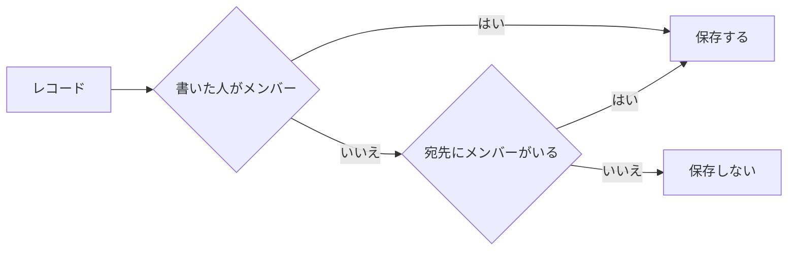

# Worker仕様: イベント受信とインデックス

用語は[用語集](../../glossary.md)を参照する。

## 保存する範囲

メンバーのレコードは全部保存する。メンバー以外のレコードは、宛先にメンバーがいるものだけ保存する。

宛先は、名指しの相手と、フォロワーに届く種類では書いた人のフォロワーを合わせたもの。

| 種類                               | 名指しの相手                                 | フォロワーに届くか |
| ---------------------------------- | -------------------------------------------- | ------------------ |
| 投稿                               | 返信先・起点・引用元の作者、メンションの相手 | 届く               |
| リポスト                           | リポスト元の作者                             | 届く               |
| フォロー                           | フォローの相手                               | 届く               |
| プロフィール・プロフィールのリンク | なし                                         | 届く               |
| いいね                             | いいねされた投稿の作者                       | 届かない           |
| リスト・リスト項目・フィード       | なし                                         | 届かない           |

- threadgateとpostgateは、誰が書いたものでも、対象の投稿を保存済みなら保存する
- ActivityPubのサーバーと同じく、フォロー先の新しい投稿と、自分のサーバーの人に宛てた反応だけを受け取る

受け取る経路は、書いた人がメンバーかどうかで分ける。

| 書いた人     | 経路      | 過去のレコード           |
| ------------ | --------- | ------------------------ |
| メンバー     | Tap       | 登録より前の分も保存する |
| メンバー以外 | Jetstream | 保存しない               |

メンバー以外の過去の分まで取り込むと、フォロー先すべてのリポジトリを読むことになり、小さいサーバーでは処理しきれない。

保存したものの表示に要るレコードは、保存していなければPDSから取りに行く。

| 取りに行くもの                                     | いつ                             |
| -------------------------------------------------- | -------------------------------- |
| 引用・リポストの元投稿                             | 保存した投稿・リポストが指すとき |
| 返信先と起点の投稿                                 | 保存した返信が指すとき           |
| メンバーがいいねした投稿                           | いつのいいねでも                 |
| 固定投稿                                           | 受け取ったプロフィールが指すとき |
| 保存したレコードの作者のプロフィールとハンドル     | 保存していないとき               |
| フォロー・リスト項目の相手のプロフィールとハンドル | 書いた人がメンバーのとき         |

PDSから取ったレコードからは広げず、引用元だけを2つ先までたどる。

フォローや登録が変わったときは、次のように扱う。

| 変化                       | 扱い                                                   |
| -------------------------- | ------------------------------------------------------ |
| メンバーがフォローした     | 相手の以後の投稿を保存する。過去の投稿は取らない       |
| メンバーがフォローを外した | 相手の保存済みのレコードは残す                         |
| 登録された                 | 全レコードを受け取る。登録前に保存しなかった分も埋まる |
| 登録を解除した             | 保存済みのレコードは残す                               |

あとからメンバーになった人宛てのいいねは、登録前の分を取り直さない。ActivityPubの引っ越しでも、いいねは移らない。

## Tapからのイベント受信

Tapからメンバーのイベントを受け取り、recordイベントではレコードをインデックスし、identityイベントではアカウントの状態を保存する。

| ID        | 仕様                                                                |
| --------- | ------------------------------------------------------------------- |
| channel-1 | イベントは処理を終えてからTapにackする                              |
| channel-2 | サポートしないコレクションのrecordイベントは、保存せずにackする     |
| channel-3 | DBに保存できなかったイベントはackしない                             |
| channel-4 | スキーマに合わないレコードなど、処理しないと決めたイベントはackする |
| channel-5 | イベントは1件ずつ処理し、処理を終えるまで次のイベントを読まない     |

ackしなかったイベントは、Tapがしばらくしてから再送する。Tapはリポジトリごとにイベントの順序を守るので、処理しないイベントもackしないと、そのリポジトリのイベントが止まってしまう。読むのを止めている間、待っているイベントはTapに溜まる。

## Jetstreamからのイベント受信

`JETSTREAM_URL` のJetstreamから、メンバー以外のアカウントのイベントを受け取る。既定はBluesky公式のJetstream。

| ID           | 仕様                                                                                             |
| ------------ | ------------------------------------------------------------------------------------------------ |
| jetstream-1  | 追跡アカウントの投稿を保存する                                                                   |
| jetstream-2  | メンバーのレコードは保存しない                                                                   |
| jetstream-3  | メンバー以外のレコードは、宛先にメンバーがいるものだけ保存する                                   |
| jetstream-4  | 保存済みのレコードが削除されたら削除する                                                         |
| jetstream-5  | 追跡アカウントのハンドルを保存する                                                               |
| jetstream-6  | 追跡アカウントの状態を保存する                                                                   |
| jetstream-7  | 止まっていた間のイベントは、再開したときに受け取る                                               |
| jetstream-8  | 保存できなかったイベントは、受け取り直して保存する                                               |
| jetstream-9  | メンバーがフォローしたアカウントの、以後の投稿を保存する                                         |
| jetstream-10 | メンバーの誰もフォローしなくなったアカウントの、以後のレコードは、メンバー宛てのものだけ保存する |
| jetstream-11 | Jetstreamがさかのぼれる期間より長く止まっていたときは、欠けた期間をログとメトリクスに出す        |

- メンバーのレコードはTapが検証して届けるので、Jetstreamの分は使わない
- Jetstreamのイベントは署名を検証できないので、接続先のJetstreamを信用する
- フォローや登録の直後に書かれたレコードは、取りこぼすことがある
- 公式のJetstreamがさかのぼれるのは36時間。それより長く止まった間のイベントは保存しない
- 欠けた期間は埋めない。追跡アカウントのレコードはPDSに残っていて、期間が分かれば後から取り直せるため

## レコードのインデックス

TapとJetstreamから受け取ったレコードをDBに保存・削除する。対象は投稿、リポスト、いいね、フォロー、プロフィール、プロフィールのリンク、フィード、リスト、リストの項目、threadgate、postgate。「全種類」と書くときはこの対象を指し、ブロックやスターターパックなどは、メンバー本人のものでも保存しない。

| ID       | 仕様                                                                                               |
| -------- | -------------------------------------------------------------------------------------------------- |
| index-1  | 作成・更新されたレコードを保存する                                                                 |
| index-2  | 削除されたレコードを削除する                                                                       |
| index-3  | スキーマに合わないレコードは保存しない                                                             |
| index-4  | null文字を含むレコードは保存しない                                                                 |
| index-9  | threadgateとpostgateは、同じアカウントの同じrkeyの投稿に付くものだけ保存する                       |
| index-10 | 保存済みのアカウントは、ハンドルと状態が変わらなければ更新しない                                   |
| index-11 | いいねは、いいねした人かいいねされた投稿の作者がメンバーのものだけ保存する                         |
| index-12 | バックフィルのレコードから積むジョブは、ライブのものより低い優先度で積む                           |
| index-13 | アカウントを保存するときは、管理者権限を書き換えない                                               |
| index-15 | 投稿のgallery埋め込みの画像を、images埋め込みと区別して保存する                                    |
| index-16 | 投稿のvideo埋め込みのメタデータを保存する                                                          |
| index-17 | フォローとリスト項目の相手のプロフィールとハンドルは、メンバーの分だけ取る                         |
| index-18 | 保存した返信の返信先と起点の投稿は、保存していなければPDSから取得する                              |
| index-20 | メンバーがいいねした投稿は、保存していなければPDSから取得する                                      |
| index-22 | PDSから取得した投稿の返信先と起点は取得しない                                                      |
| index-23 | 引用を禁止した投稿への作者以外の引用は、引用禁止の違反として保存する                               |
| index-24 | 引用禁止の違反は、リアルタイムに受け取った投稿でだけ判定する                                       |
| index-25 | threadgateとpostgateは、対象の投稿を保存済みのときだけ保存する                                     |
| index-26 | スレッドの起点の投稿の返信制限で許されていない返信は、返信制限の違反として保存する                 |
| index-27 | 返信制限の違反は、リアルタイムに受け取った投稿でだけ判定する                                       |
| index-28 | メンバー以外のレコードは、宛先にメンバーがいるものだけ保存する                                     |
| index-29 | 投稿・リポスト・フォロー・プロフィール・プロフィールのリンクは、書いた人のフォロワーも宛先に含める |

| 対象                 | 理由                                                                                                                                                                  |
| -------------------- | --------------------------------------------------------------------------------------------------------------------------------------------------------------------- |
| null文字             | null文字を含む文字列はPostgreSQLに保存できない                                                                                                                        |
| rev                  | 古いコミットを捨てる判定はしない。Tapはリポジトリのrev以下のコミットを捨て、ライブのイベントはDIDごとにackを待って順に送る。公式のAppViewも同じく順序だけに頼っている |
| threadgate・postgate | threadgateとpostgateは対象の投稿と同じrkeyを持つので、appviewは投稿から引ける                                                                                         |
| 対象の投稿           | 投稿を保存しないなら、その制限も使わない。保存した投稿の制限は、書いた人の区分を問わず保存する。保存しないと、公式では隠れる返信や引用が表示されてしまう              |
| アカウントの更新     | アカウントの更新は行ロックを取るので、同じアカウントのコミットが続くバックフィルでロック待ちが起きる                                                                  |
| いいね               | いいねは件数が多く、フォロワーに届くものとして保存するとDBが大きくなる。ActivityPubでも、いいねは本人と投稿の作者のサーバーにしか届かない                             |
| いいねした投稿       | メンバーがいいねした投稿は、いいねの一覧の表示に要る。メンバー以外のいいねの分は取らない                                                                              |
| 管理者権限           | 管理者権限はappviewだけが書き換える                                                                                                                                   |
| フォローの相手       | フォローやリスト項目を書いた人がメンバーでなければ、相手はアカウントだけ保存する。追跡アカウントのフォロー先のプロフィールまで取ると、DBが大きくなる                  |
| 返信先と起点         | 返信の表示には返信先と起点が要る。PDSから取得した投稿の分まで取ると、スレッドをさかのぼって保存する投稿が増え続ける                                                   |
| 動画                 | 動画の本体は保存せず、再生には公式の動画サーバーを使う。字幕は保存しない                                                                                              |

メンバー宛ては、投稿なら返信先・スレッドの起点・引用元の作者かメンションの相手、リポストなら対象の作者、フォローなら相手にメンバーがいること。プロフィールやリストなど、ほかの種類は宛先を持たない。ほかのレコードを読まずに、レコードの中身だけで決める。起点の作者を見るので、メンバーの投稿から始まるスレッドは、メンバー以外どうしの返信も含めてそろう。

PDSは引用の禁止を強制しないので、守らせるのはAppViewの役目になる。公式AppViewと同じく、引用した時点のpostgateで判定し、後からpostgateが変わっても判定し直さない。バックフィルや取得したレコードで読めるのは今のpostgateで、引用した時点のものではない。規則に合った引用を誤って違反にすると直す機会がないので、ここは公式と変えて判定しない。

返信制限も同じく、PDSが強制しないのでAppViewが守らせる。規則（メンション、フォロー、フォロワー、リスト）は公式AppViewと同じにし、起点の投稿者本人の返信と、返信制限を保存していない投稿への返信は許す。判定の時点とバックフィルの扱いは引用禁止と同じにする。

PDSから取得するレコードは、保存したレコードの表示に要るものなので絞らない。

保存する範囲を絞っているので、次の制約を受け入れる。

| 制約                     | 内容                                                                                                                                                                                                 |
| ------------------------ | ---------------------------------------------------------------------------------------------------------------------------------------------------------------------------------------------------- |
| 受け取る前のレコード     | メンバー以外のアカウントのレコードは、受け取り始めるより前の分が入らない。フォローした直後の相手のプロフィールには、次に投稿するまで投稿が出ない。フォロー数とフォロワー数も、受け取った分だけになる |
| 届かない削除・更新       | 削除や更新が届かないデータは、そのまま残る。PDSから取得した投稿とプロフィールは取得した時点のままになる                                                                                              |
| その他のアカウントの状態 | メンバーでも追跡アカウントでもないアカウントの、状態（停止・削除）とハンドルの変化は反映しない                                                                                                       |
| バックフィルの通知       | バックフィルで保存したいいねや返信は、通知にならない                                                                                                                                                 |

## リポジトリのrevの記録

メンバーごとに、最後に処理したコミットのrevを記録する。appviewはこれをread-after-writeのために返す。

| ID        | 仕様                                                                        |
| --------- | --------------------------------------------------------------------------- |
| repoRev-1 | recordイベントを処理したら、そのアカウントのrevをイベントのrevにする        |
| repoRev-2 | 保存しないレコードやサポートしないコレクションのイベントでも、revを記録する |
| repoRev-3 | 記録済みより古いrevでは更新しない                                           |
| repoRev-4 | DBに保存できなかったイベントのrevは記録しない                               |
| repoRev-5 | revを記録できなかったイベントのレコードは保存しない                         |

PDSは、revより新しい本人のレコードを、応答にすでにあるか確かめずに足す。保存しないコミットでrevを記録しないと、取り込み済みの投稿が二重に出る。逆に、保存できなかったイベントのrevを記録すると、PDSがその投稿を足さなくなる。

## レコードの取得

インデックス中に必要になった、保存していないレコード(引用された投稿など)をPDSから取得して保存する。

| ID            | 仕様                                                                                 |
| ------------- | ------------------------------------------------------------------------------------ |
| fetchRecord-1 | PDSにレコードがなければ、再試行せずに終える                                          |
| fetchRecord-2 | PDSにリポジトリがないか、停止・凍結されていれば、再試行せずに終える                  |
| fetchRecord-3 | DIDが登録されていなければ、再試行せずに終える                                        |
| fetchRecord-4 | それ以外の失敗では再試行する                                                         |
| fetchRecord-5 | 保存済みのレコードは取得しない                                                       |
| fetchRecord-6 | 取得したレコードからさらに取得するのは、2つ先までにする                              |
| fetchRecord-7 | TapかJetstreamから受け取ったプロフィールが指す固定投稿を、保存していなければ取得する |
| fetchRecord-8 | PDSから取得したプロフィールが指す固定投稿は取得しない                                |

固定投稿は、追跡アカウントの古い投稿など保存していないことがあるので、プロフィールの表示のために取得する。PDSから取得したプロフィールからは広げない。

結果が変わらない失敗で再試行すると、失敗したジョブがキューに溜まり続ける。DNSの失敗や5xxの応答などは一時的なことがあるので再試行する。

引用やリプライをどこまでもたどると、メンバーと関わりの薄いレコードでDBの容量が増えるので、たどるのは2つ先までにする。

## キュー件数のログ

ジョブの滞留を確認できるように、キューごとの件数を1分ごとにログへ出す。
